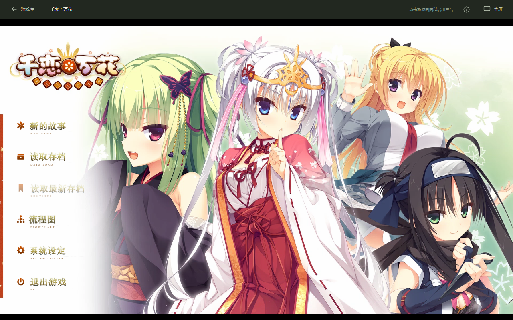
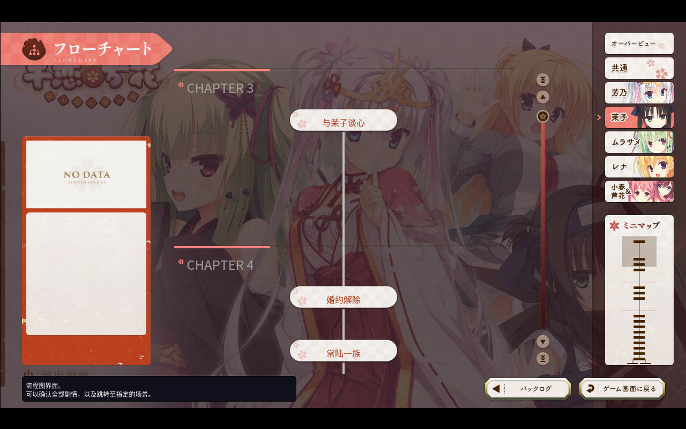

<div align="center">

# KiriHub

**把 NAS 里的 Galgame，带进浏览器。**

Self-hosted visual novel library · Single-thread KiriKiri in the browser

[在线试玩](http://kirkirhub.sola.beer/) · [千恋万花演示版源码](https://github.com/goverdking/KiriHub/releases/tag/legacy-senren-source-45babb9d5915) · [引擎开发进度](docs/ENGINE_PROGRESS.md) · [反馈问题](https://github.com/goverdking/KiriHub/issues)

</div>



KiriHub 是一个学生利用课余时间开发的自托管视觉小说项目：游戏放在自己的 NAS 上，通过网页书架启动，在浏览器中运行。**目前已有《千恋＊万花》的单线程运行演示**；更广泛的 Krkr 兼容与多引擎支持正在继续探索。

## 先来试一试

**[打开试玩站 → kirkirhub.sola.beer](http://kirkirhub.sola.beer/)**

进入书架，启动《千恋＊万花》。首次加载需要下载引擎和部分资源；进入游戏后点击画面启用声音。存档保存在当前浏览器，换设备或换域名不会自动同步。演示站由个人 NAS 提供服务，加载速度和在线时间受家用网络影响。

试玩使用的是此前实际运行过的单线程版本 `45babb9d5915`，与 main 中继续补齐接口的通用引擎开发版分开。这里的“已运行”指下列实际测试范围，尚未验证全路线通关。

## 已经做到什么

- **单线程运行 Krkr**：浏览器 Wasm，不开启 pthread，使用 Asyncify 处理异步资源读取。
- **保持原始 XP3 不变**：引擎外置兼容脚本、字体和媒体映射，不需要重打游戏资源包。
- **按需读取 NAS 资源**：HTTP Range 分块加载与缓存，不必先下载完整游戏包。
- **从书架进入游戏**：桌面、手机布局，收藏、游玩状态和全屏播放器。
- **可查看的真实进展**：公开引擎补丁、插件适配源码和不依赖商业游戏的接口测试。

| 《千恋＊万花》历史测试 | 结果 |
| --- | --- |
| 普通开局、Ctrl 加速、首个选项 | 通过 |
| 原第二幕转场崩溃点、OP 播放与返回剧情 | 有通过记录 |
| 保存、刷新页面后读档 | 通过 |
| 流程图 | 部分共通篇、芳乃线和茉子线节点跳转通过 |
| 全部路线、所有结局、长时间公网及手机实机 | 尚未完整验收 |

9-nine- 仍未跑通，不列入已兼容游戏。演示依靠针对游戏的独立兼容配置，暂不承诺任意 Krkr 游戏即传即玩。

## 当时的实测画面

以下是 2026-11-15 至 11-16 保存的原始测试截图，包含旧界面命名。

| NAS 游戏书架 | 存档读取后的游戏画面 |
| --- | --- |
|  |  |

<details>
<summary>展开流程图测试截图与来源说明</summary>



截图只展示部分节点测试，不是全路线完成证明。[原截图来源与哈希](docs/screenshots/README.md)。游戏画面版权归原权利人所有，不随项目代码按 MIT 授权。

</details>

## 演示版、开发版与未来企划

| 部分 | 当前定位 | 去哪里看 |
| --- | --- | --- |
| 千恋万花单线程演示版 | 已有真实游戏运行记录，是试玩站当前采用的版本 | [历史源码归档](https://github.com/goverdking/KiriHub/releases/tag/legacy-senren-source-45babb9d5915) |
| 通用 Krkr 兼容引擎 | main 中的开发工作；逐步补齐 Kirikiroid2 常见接口与插件 | [已完成的接口工作与检查](docs/ENGINE_PROGRESS.md) |
| NAS 游戏管理后端 | 本地目录、ZIP / 7z 导入、XP3 识别、浏览器试运行及加入书架 | [部署说明](docs/DEPLOYMENT.md) |
| 更多游戏与多引擎 | 后续计划；目前未实现的引擎不算可玩 | [路线图](docs/ROADMAP.md) |

通用引擎目前包含 CSV、字体、KAGParser、文字布局、GDI 绘图、透明 AMV 和视频事件等适配，记录了 145 项接口及合成素材检查。**这些检查不等于 145 款游戏兼容，也不代表 main 已完成《千恋万花》的整段回归。** Motion / Emote、更多插件和真实游戏回归仍在推进。

## 在本地看看书架

需要 Python 3.11+。公开源码默认是空书架，不附游戏、封面包或存档。

```sh
python tools/dev_server.py web 8300
```

打开 <http://127.0.0.1:8300/>。这提供前端预览；管理 API、游戏和编译后的运行时需要另外准备，见 [部署说明](docs/DEPLOYMENT.md) 与 [构建说明](docs/BUILD.md)。

```sh
python -m unittest discover -s backend -p "test_probe_contract.py" -v
```

## 源码与贡献

```text
web/                  书架、启动页与管理前端
backend/              游戏导入、资源服务与试运行检查
engine/patches/       对固定上游版本的引擎补丁
engine/overlay/       新增引擎代码、插件与兼容脚本
tests/engine/         不依赖商业游戏的 TJS 测试
docs/                 构建、部署、开发进度与实测截图
LICENSES/             上游与依赖许可证
```

如果这个方向对你有用，欢迎 **Star 关注后续进展**，也欢迎试玩后提交浏览器、设备、遇到的场景与错误信息。希望一起改进兼容性、移动端体验和构建流程的朋友，可以从 [贡献说明](CONTRIBUTING.md) 开始。

项目使用 AI 辅助开发，基于 [krkrsdl2](https://github.com/krkrsdl2/krkrsdl2)、[KrkrZ](https://github.com/krkrsdl2/krkrz)，部分插件适配参考 [fenghengzhi/krkr2 公开重建分支](https://github.com/fenghengzhi/krkr2)。固定版本见 [upstream-lock.json](engine/upstream-lock.json)。这不代表与手机 Kirikiroid2 已完全等价。

本项目独立于其他名为 WebGAL 的项目。原创代码使用 MIT，第三方代码和截图保留各自权利，见 [第三方说明](THIRD_PARTY_NOTICES.md)。请勿提交游戏本体、解密密钥、付费素材、用户存档或账号凭据。
