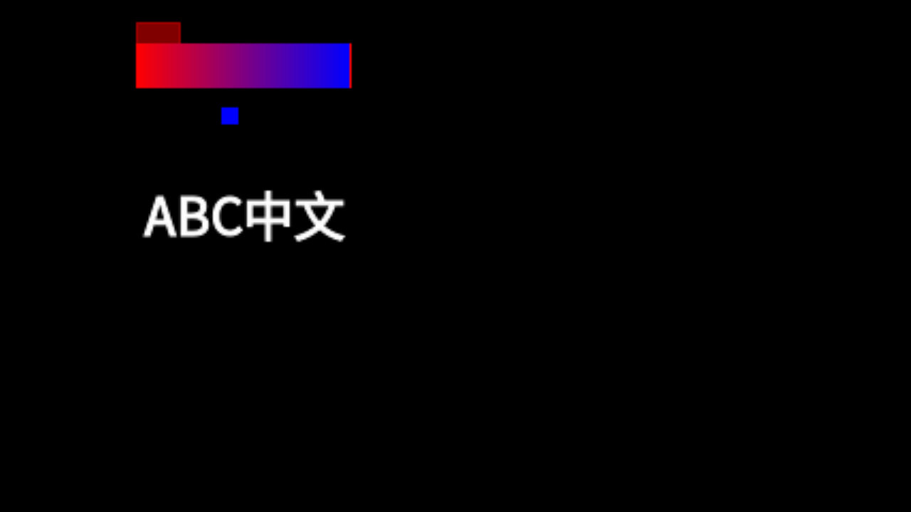

# 通用兼容引擎：开发进度

这是 main 中继续对照 Kirikiroid2 公开实现补齐接口的研究工作。在线演示使用此前针对《千恋＊万花》验证过的单线程版本；这里的接口检查不能代替真实游戏试玩。

| 领域 | 当前状态 |
| --- | --- |
| CSV、字体接口、KAG 解析、文字布局 | 已接入原生实现，有针对性契约测试 |
| VideoOverlay | 准备、帧事件、分段循环、Layer 输出已测试 |
| GDI / LayerExDraw | 常见绘图、裁剪、变换、混合、渐变、图片、中文字形已测试；仍有缺项 |
| AlphaMovie / AMV | 两类透明通道格式、逐帧解码、循环与定位已用合成素材测试 |
| Motion / Emote | 待实现，是下一阶段重点 |
| XP3Filter / PackinOne | 待补依赖与绑定 |
| 完整游戏与移动端 | 尚未建立系统性的兼容覆盖率 |

当前本机记录了 **145 项检查**：58 项契约、31 项绘图、36 项 AMV、16 项视频和 4 项后端发布门槛检查。这些是针对接口及合成素材的检查，不能换算为游戏兼容率；公开源码整理后的自动测试状态见 CI。

详细边界、已知问题和下一步见 [路线图](ROADMAP.md)。
